Dělám weby pro klienty a nástroje, se kterými LLM agenti zvládnou opravdovou práci na vlastním počítači.

| Projekt | Co to je |
| --- | --- |
| **Elaris** | Harness pro LLM agenty: jedno zadání, tým specialistů, CLI i web. Moje maturitní práce. *(soukromé)* |
| **video-system** | Ze scénáře krátké video: hlas, animace v Remotion, titulky po slovech. *(soukromé)* |
| [Tři Mistři](https://trimistri.cz) | Web, Instagram a interní aplikace pro malířskou firmu |
| [Wash&Wrap](https://washwrap.cz) · [Brandriders](https://brandriders.sk) · [OKRiders](https://okriders.sk) | Weby pro klienty |
| [rocm-llm-benchmark](https://github.com/RomanKaxo/rocm-llm-benchmark) | Rychlost LLM modelů 7B–34B na AMD Radeon AI PRO R9700 |
